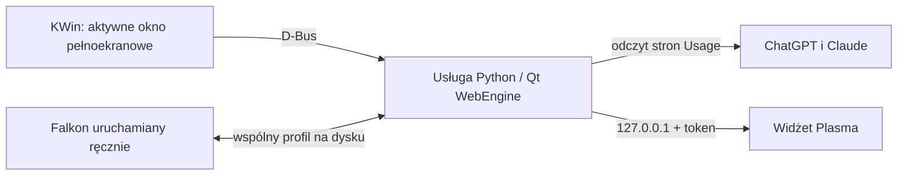

# Dokumentacja techniczna

## Przepływ danych



`backend/app.py` uruchamia usługę użytkownika `limity-ai-widget.service`. Tworzy jedną niewidoczną stronę Qt WebEngine i kolejno odczytuje strony Usage obu usług. Falkon jest potrzebny tylko do ręcznego logowania lub oglądania stron. Oba procesy używają dedykowanego profilu `limity-ai-widget`, ale nie powinny korzystać z niego jednocześnie: przed startem Falkona czytnik zamyka własną stronę i profil, a po zamknięciu Falkona tworzy je ponownie.

Adresy zapisane w czytniku to `https://chatgpt.com/settings/usage?tab=overview` oraz `https://claude.ai/settings/usage`.

Usługa pobiera `document.body.innerText`, przekazuje tekst do `backend/usage_parser.py` i przechowuje wynik w pamięci. Parser przelicza `x% used` na `100 − x%` pozostałego limitu, a `x% left` i `x% remaining` zachowuje jako procent pozostały. Zwraca tylko procent i lokalny termin resetu dla sesji i tygodnia. Gdy Claude przekieruje adres Usage na `/new`, czytnik klika przycisk „Usage” w niewidocznej stronie, po czym ponawia odczyt.

`plasmoid/contents/ui/main.qml` co 3 sekundy pobiera stan z lokalnego API. Panel pokazuje mniejszy z dostępnych procentów danej usługi. Rozwinięty widżet pokazuje oba limity, ich reset i godzinę ostatniego udanego odczytu. Brak konkretnego limitu ma wartość `null`; widżet wyświetla wtedy „brak danych”.

`kwin/contents/code/main.js` raportuje przez D-Bus, czy aktywne okno jest pełnoekranowe. Sygnał jest też wysyłany co 30 sekund, więc usługa odzyskuje stan po restarcie. Jeśli przez ponad 90 sekund nie otrzyma raportu, wstrzymuje odczyt. Odczyt automatyczny jest wyłączony, gdy aktywne okno jest pełnoekranowe; po wyjściu z tego trybu następuje opóźnienie 15 sekund. To zapobiega wznowieniu odczytu po krótkim przełączeniu z gry na inne okno. Ręczny przycisk odświeżania w widżecie jest świadomym żądaniem użytkownika i może uruchomić odczyt mimo pauzy.

## Stan i lokalne API

API nasłuchuje tylko na `127.0.0.1`, domyślnie na porcie `41817`. Każde żądanie musi zawierać `X-Limity-Token` równy wartości w `~/.config/limity-ai-widget/config.json`. Instalator umieszcza tę samą wartość w pliku `Config.js` zainstalowanego widżetu. Nie dodawaj wartości tokenu do repozytorium ani do zgłoszeń błędów.

| Żądanie | Działanie |
| --- | --- |
| `GET /status` | Zwraca aktualny stan. |
| `POST /refresh` | Zleca odczyt stron; odpowiada `202`, zanim odczyt się zakończy. |
| `POST /open?service=all` | Otwiera obie strony w dedykowanym Falkonie. Parametr może też mieć wartość `chatgpt` lub `claude`. |
| `POST /finish` | Zleca zamknięcie okien dedykowanego Falkona przez KWin. |

Każda usługa w `GET /status` ma pola `session` i `weekly`, a każde z nich ma `remaining` (`0–100` lub `null`) i `reset` (tekst albo `null`). Ma też `state` i `lastRead`. Stan `checking` oznacza oczekiwanie na pierwszy wynik; `ready` oznacza, że rozpoznano co najmniej jeden procent; `login` oznacza potrzebę logowania; `unavailable` oznacza nieudany odczyt. `ready` nie gwarantuje obecności obu limitów.

Na poziomie całej usługi `paused` sygnalizuje pełny ekran lub brak aktualnego raportu KWin, `fullscreenKnown` mówi, czy raport dotarł, `browserOpen` oznacza, że dedykowany Falkon wciąż pracuje, a `busy` oznacza trwający odczyt. Po udanym odczycie `lastRead` zawiera lokalny czas z przesunięciem strefy. Podczas pauzy ostatnie wartości pozostają widoczne. Nieudany odczyt lub wygaśnięcie logowania może wyczyścić wartości danej usługi.

## Pliki i trwałość danych

| Ścieżka | Rola |
| --- | --- |
| `backend/app.py` | Niewidoczny czytnik, sterowanie Falkonem, lokalne API, obsługa D-Bus. |
| `backend/usage_parser.py` | Rozpoznawanie procentów i terminów resetu. |
| `plasmoid/contents/ui/main.qml` | Panel i szczegóły widżetu. |
| `kwin/contents/code/main.js` | Wykrywanie aktywnego okna pełnoekranowego. |
| `scripts/install.sh`, `scripts/uninstall.sh` | Instalacja i usuwanie pakietów oraz usługi. |
| `scripts/check_live.py` | Test bieżącego stanu bez wypisywania tokenu. |
| `tests/test_usage_parser.py` | Przykłady tekstu stron i oczekiwane wyniki parsera. |
| `~/.config/limity-ai-widget/config.json` | Port, lokalny token i ścieżka danych; uprawnienia `0600`. |
| `~/.local/share/limity-ai-widget/browser-config/falkon/profiles/limity-ai-widget` | Dedykowany profil i sesje logowania. |
| `~/.local/share/plasma/plasmoids/org.limityai.widget/contents/code/Config.js` | Port i lokalny token dla widżetu; uprawnienia `0600`. |

Katalog `.deps` zawiera opcjonalne moduły PyQt6 rozpakowane przez instalator i jest ignorowany przez Git. Usługa systemd wskazuje bezpośrednio na `backend/app.py` w katalogu projektu. Po przeniesieniu projektu instalator trzeba uruchomić ponownie. Obecne skrypty diagnostyczne i domyślna ścieżka konfiguracji czytnika zakładają standardowe lokalizacje `~/.config` i `~/.local/share`.

## Zmiany w parserze i sprawdzanie

Parser szuka nagłówków sesji i tygodnia oraz procentów w ograniczonym fragmencie tekstu po nagłówku. Dla aktualnego układu Claude ma dodatkową regułę: jeśli po sesji nie ma osobnego nagłówka tygodnia, bierze drugą parę „reset + procent”. Nową wersję strony najlepiej odwzorować krótkim przykładem w `tests/test_usage_parser.py`, aby przypadkowy procent z innej części strony nie stał się limitem.

```bash
python3 -m unittest discover -s tests -v
python3 -m py_compile backend/app.py backend/usage_parser.py
python3 scripts/check_live.py
```

`python3 scripts/check_live.py --refresh` dodatkowo zleca odczyt stron i czeka na wynik. Odmawia pracy, gdy pełny ekran jest aktywny lub Falkon jest otwarty. Wynik `GREEN` wymaga trzech wartości: tygodnia ChatGPT oraz sesji i tygodnia Claude. Odrębny procent sesji ChatGPT nie jest obecnie widoczny na stronie tego konta i parser zwraca dla niego `null`.

Po zmianie Pythona zrestartuj `limity-ai-widget.service`. Po zmianie QML ponownie uruchom `bash scripts/install.sh`; działający panel Plasma może wymagać restartu `plasma-plasmashell.service`, aby wczytać nowy plik.
